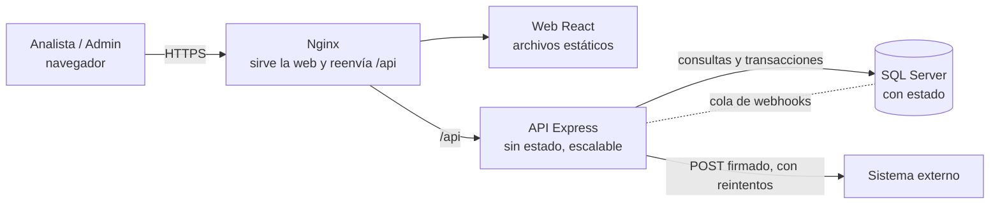

# Cómo funciona y por qué se hizo así

Este documento explica la aplicación y responde las preguntas que hace la prueba.
Está escrito para poder sustentarlo: cada decisión trae su razón.

## 1. La aplicación en pocas palabras

Un analista de la cooperativa entra a la web, registra la solicitud de crédito de un asociado y la va moviendo por etapas
(solicitado → en estudio → aprobado → desembolsado, o rechazado/cancelado). Cada cambio queda guardado en un historial.
Al crear una solicitud, el sistema avisa a otro sistema por internet (webhook) y guarda si el aviso llegó o no.

## 2. Arquitectura



**Con estado (hay que protegerlo):** SQL Server (créditos, historial, cola de webhooks).
**Sin estado (se puede apagar y levantar copias sin perder nada):** la API y la web.
La sesión del usuario viaja en un token firmado (JWT), no se guarda en la memoria del servidor; por eso se pueden tener varias copias de la API.

Dentro de la API el código está en capas simples:

| Archivo | Para qué |
|---|---|
| `rutas.ts` | Recibe la petición HTTP y la entrega al servicio. No tiene reglas. |
| `servicio.ts` | **Todas las reglas de negocio** y validaciones. |
| `repo.sql.ts` | Todo el SQL. Es lo único que conoce la base de datos. |
| `webhook.ts` | Envío de los webhooks con reintentos. |
| `app.ts` | Seguridad, autenticación y formato de errores. |

## 3. Base de datos (`backend/sql/schema.sql`)

| Tabla | Para qué |
|---|---|
| `Asociados` | Datos del asociado, una sola vez (identificación única). |
| `Creditos` | La solicitud. |
| `HistorialCredito` | Bitácora de cada cambio. Solo se agregan filas. |
| `WebhookEventos` | Cola y traza de los webhooks. |
| `Usuarios` | Usuarios de la API (clave con hash). |

Decisiones y razones:

- **Dinero en `DECIMAL(18,2)`**, nunca `float`: los decimales binarios no son exactos y en finanzas se acumula el error. La tasa es `DECIMAL(5,2)`.
- **Llaves primarias** numéricas autoincrementales (`IDENTITY`): rápidas y simples. El `NumeroCredito` («CR-2026-000123») es aparte, único y se genera con una `SEQUENCE`, así dos créditos nunca reciben el mismo número aunque se creen al mismo tiempo.
- **Llaves foráneas** de Crédito→Asociado, Historial→Crédito y Webhook→Crédito: no pueden existir registros huérfanos.
- **Restricciones `CHECK`** (valor > 0, tasa ≥ 0, cuotas > 0, estado válido): la base protege los datos aunque alguien se salte la API (un script, otra aplicación).
- **Índices:** por estado + fecha (listado y dashboard), por asociado, y un índice único filtrado que evita créditos activos duplicados (ver punto 5). Los de la cola solo indexan lo pendiente.
- **Fechas** en `DATETIME2` y en UTC; la web las convierte a la hora local al mostrarlas. Así no hay líos de zonas horarias ni horario de verano.
- **Estados** como texto con `CHECK` en vez de una tabla aparte: son 6 valores fijos que cambian con el negocio y el código; se leen mejor en las consultas. Si crecieran o necesitaran textos configurables, pasarían a una tabla.
- **Borrado lógico** (`Eliminado = 1`): en un sistema financiero no se pierde información; además queda constancia en el historial.

## 4. Estados y transiciones

| Desde | Puede pasar a |
|---|---|
| SOLICITADO | EN_ESTUDIO, CANCELADO |
| EN_ESTUDIO | APROBADO, RECHAZADO, CANCELADO |
| APROBADO | DESEMBOLSADO, CANCELADO |
| RECHAZADO, DESEMBOLSADO, CANCELADO | (finales, no cambian) |

Se mantuvo el modelo sugerido. Por ejemplo, RECHAZADO → DESEMBOLSADO responde `422 TRANSICION_INVALIDA` y dice a qué estados sí se puede pasar.
Para rechazar es obligatorio escribir el motivo.

## 5. Reglas de negocio: dónde están y por qué

**Dónde:** en `servicio.ts` (y las validaciones de campos en los esquemas `zod` del mismo archivo).

**Por qué ahí y no en las rutas o solo en la base de datos:**

- Las rutas solo traducen HTTP; si tuvieran reglas habría que repetirlas en cualquier otra entrada (el webhook, un proceso por lotes).
- El servicio se prueba sin web ni base de datos, y es el único punto que hay que revisar para saber «qué permite el negocio».
- Algunas reglas **también** están en la base de datos (`CHECK`, índice único). Es defensa en capas: el servicio da el mensaje claro al usuario, y la base garantiza que nada inválido entre aunque el código falle o dos peticiones lleguen a la vez.

Reglas implementadas:

| Regla | Respuesta si se incumple |
|---|---|
| `valorSolicitado > 0`, `tasaInteres >= 0` (máx. 100), `numeroCuotas > 0` (máx. 360, entero) | 422 `VALIDACION`, con el detalle por campo |
| Identificación de 5 a 15 dígitos; tipo y forma de pago de listas conocidas | 422 `VALIDACION` |
| **Duplicados:** un asociado no puede tener dos créditos activos (solicitado, en estudio o aprobado) del mismo tipo | 409 `CREDITO_DUPLICADO` |
| Solo se edita en SOLICITADO o EN_ESTUDIO | 422 `CREDITO_NO_EDITABLE` |
| Transiciones de estado válidas | 422 `TRANSICION_INVALIDA` |
| Rechazar exige observación | 422 `OBSERVACION_REQUERIDA` |
| Un desembolsado no se elimina | 422 `CREDITO_NO_ELIMINABLE` |
| Solo el admin elimina | 403 `SIN_PERMISO` |

**Sobre el control de duplicados:** se eligió «mismo asociado + mismo tipo de crédito mientras el anterior siga vivo» porque es lo que normalmente quiere una cooperativa
(puede pedir uno de vivienda y otro de vehículo, pero no dos libres inversión abiertos). Se revisa en el servicio y además lo garantiza un índice único filtrado en SQL,
que protege cuando dos personas envían la misma solicitud en el mismo segundo.

**Cambio de estado concurrente:** la actualización lleva `WHERE Estado = <estado que leí>`. Si otra persona lo cambió justo antes, no se actualiza nada y se responde `409 CONFLICTO_ESTADO` en lugar de pisar el cambio ajeno.

## 6. Webhook

**Qué hace:** al crearse un crédito se envía a `WEBHOOK_URL` un `POST` con este formato:

```json
{ "event": "credito.creado", "eventId": "8f7d...", "timestamp": "2026-09-07T18:00:00Z",
  "data": { "id": 123, "numeroCredito": "CR-2026-000123", "identificacionAsociado": "1001234567", "valorSolicitado": 15000000, "estado": "SOLICITADO" } }
```

**Reutiliza la lógica de creación, sin segundo INSERT de crédito:** el evento se arma dentro del mismo método `crear` del servicio.
Esa operación guarda en **una sola transacción** el crédito, su primera línea de historial y el evento pendiente. O se guarda todo o no se guarda nada.
Un proceso aparte lee los eventos pendientes y los envía (patrón *outbox*). Nunca se inserta un crédito por segunda vez.

**Por qué no se llama al externo directamente al crear el crédito:** si el externo estuviera lento o caído, o el servidor se apagara justo entre guardar y avisar, se perdería el aviso
o se haría esperar al usuario. Con la cola, el aviso queda guardado pase lo que pase.

**Traza:** la tabla `WebhookEventos` guarda el contenido enviado, cuántos intentos, el código HTTP y el último error. Se ve en el detalle del crédito en la web.

**¿Qué pasa si el sistema externo no responde, da error o está caído?**

| Situación | Qué hace el sistema |
|---|---|
| No responde / está caído | A los 5 segundos corta (timeout), anota el error, deja el evento `PENDIENTE` y lo reintenta |
| Responde 4xx/5xx | Igual: se anota el código y se reintenta |
| Reintentos | A los 30 s, 2 min, 10 min, 1 hora y 6 horas (cada vez más espaciados para no ahogar al externo) |
| Se agotan 5 intentos | Pasa a `FALLIDO`; queda visible para revisión manual o reenvío |
| Se reinicia el servidor | Nada se pierde: los pendientes están en la base de datos y se retoman |
| El crédito | **Se crea igual.** El webhook nunca bloquea ni deshace la creación |

**Seguridad y duplicados del webhook:** cada envío va firmado (`X-Signature`, HMAC-SHA256 con un secreto compartido) para que el receptor sepa que viene de aquí.
Lleva un `eventId` único: si por un reintento el externo recibe el mismo aviso dos veces, puede ignorarlo (se entrega «al menos una vez», y el `eventId` permite que sea idempotente).

**Receptor de ejemplo:** la prueba permitía implementarlo o solo guardar la traza. Se hicieron ambas cosas: la API tiene `POST /api/webhooks/creditos`, que valida la firma, y por defecto el webhook se envía ahí para poder ver todo el flujo sin servicios externos.

## 7. Seguridad

| Mecanismo | Para qué | Por qué |
|---|---|---|
| **Login con JWT** de 1 hora | Todas las rutas (menos login, health, docs y el receptor del webhook) exigen token | Sin estado en el servidor, fácil de escalar |
| **Claves con bcrypt** | Nunca se guarda la clave, solo su hash | Si roban la base no se leen las claves |
| **Registro de usuarios** | Cualquiera puede crear cuenta, siempre con rol analista; usuario de 4 a 30 caracteres y contraseña de 8 a 72 con mayúscula, minúscula, número y símbolo | Nadie puede darse rol de admin desde la API (un campo `rol` en la petición se rechaza). En producción convendría que un admin apruebe las cuentas nuevas |
| **Mensaje único en el login** | «Usuario o contraseña incorrectos» sin decir cuál falló | No revela qué usuarios existen |
| **Roles** (admin / analista) | Solo admin elimina → 403 | Mínimo privilegio |
| **Límite de intentos de login** (10 por minuto) | Frena adivinar claves por fuerza bruta | Respuesta 429 |
| **Validación de entradas** (zod) | Nada llega al servicio sin validar; campos desconocidos se rechazan | Evita datos basura e intentos de modificar campos protegidos |
| **Consultas parametrizadas** | Todo valor del usuario va como parámetro SQL; el orden solo acepta columnas de una lista fija | Evita inyección SQL |
| **Helmet** | Cabeceras de seguridad HTTP | Protege contra ataques comunes del navegador |
| **CORS** limitado | Solo el origen de la web | Otras páginas no pueden usar la API |
| **Secretos en variables de entorno** | Ninguna clave está en el código; `.env.example` no tiene secretos reales | En producción la API se niega a arrancar sin ellos |
| **Webhook firmado (HMAC)** | Autenticidad del mensaje | El receptor verifica que viene de la cooperativa |
| **Mensajes de error genéricos en fallos internos** | Un 500 no muestra detalles técnicos | No filtra información |

Quedó para producción real (se explica, no se implementó): HTTPS en el proxy/balanceador, tokens de renovación, bloqueo de cuenta tras varios fallos, rotación de secretos, aprobación de cuentas nuevas por un administrador y 2FA para roles sensibles.

## 8. Manejo de errores

Todas las respuestas tienen la misma forma:

```json
{ "success": false, "error": { "code": "CREDITO_NOT_FOUND", "message": "El crédito no existe" } }
```

| Código HTTP | Cuándo |
|---|---|
| 200 / 201 | Consulta o cambio correcto / creación |
| 400 | Id inválido o JSON mal formado |
| 401 | Sin sesión, token vencido o credenciales incorrectas |
| 403 | Sin permiso (ej. analista intenta eliminar) |
| 404 | El crédito o la ruta no existen |
| 409 | Duplicado, o el estado cambió mientras se procesaba |
| 422 | Datos inválidos o regla de negocio incumplida (transición, edición no permitida) |
| 429 | Demasiados intentos de login |
| 500 | Error inesperado (se registra en el log, al usuario solo un mensaje genérico) |

Se usa 422 para «entendí tu petición pero no cumple las reglas» y 400 solo cuando la petición está mal formada.
Los errores de validación traen el detalle por campo y el formulario los muestra junto a cada campo.

## 9. Auditoría y trazabilidad

Cada creación, edición, cambio de estado y eliminación agrega una fila a `HistorialCredito`: estado anterior, estado nuevo, **quién**, **cuándo** y la observación
(en las ediciones guarda qué campo cambió y de qué valor a cuál). Se escribe en la misma transacción que el cambio: no puede haber cambio sin rastro.

**¿Qué se puede modificar y qué es inmutable?**

| Puede modificarse (y solo en SOLICITADO / EN_ESTUDIO) | Debe ser inmutable |
|---|---|
| Valor, tasa, cuotas, forma de pago, tipo de crédito | **Número de crédito**, **asociado** (identificación), **fecha de solicitud** |
| Estado (solo por transiciones válidas) | **El historial**: solo se inserta, nunca se actualiza ni borra |
| | Todo crédito en estado final (desembolsado, rechazado, cancelado) |
| | Las condiciones de un crédito aprobado o desembolsado: lo pactado no se reescribe |

Razón: en finanzas lo que ya se aprobó o se pagó es un compromiso; si hay un error se corrige con un nuevo movimiento, no reescribiendo el pasado.
Si se necesita cambiar el asociado, se cancela y se crea una solicitud nueva.
La API rechaza (422) cualquier intento de enviar campos inmutables en una edición.

## 10. Pruebas automatizadas

`npm test` en `backend/` (Vitest + Supertest). 32 pruebas que cubren lo que pide la prueba, la edición y el registro de usuarios:
creación, validaciones (valor, tasa, cuotas, tipo, identificación), duplicados, consulta inexistente, paginación y filtros, flujo de estados, transiciones inválidas,
permisos (401/403) y el webhook: envío correcto con firma, error 500 del externo, sistema caído y paso a `FALLIDO` tras 5 intentos, y que el crédito se crea aunque el webhook falle.

En `frontend/` hay 27 pruebas más (Vitest y Testing Library, `npm test`): login y registro (incluido el ojo de la contraseña y los requisitos), validaciones del formulario de crear y editar, que solo se envíen los campos cambiados, filtros y paginado del listado, y qué botones ve cada rol y cada estado en el detalle. Simulan la API, así que no necesitan el backend.

Corren sobre un repositorio en memoria que respeta el mismo contrato que el de SQL Server, por eso son rápidas y no necesitan base de datos.
**Límite honesto:** estas pruebas no ejercitan el SQL real. Para eso lo que sigue sería una prueba de integración contra un SQL Server en contenedor (el flujo principal sí se comprobó a mano, ver punto 13).

## 11. Despliegue en producción

| Tema | Propuesta |
|---|---|
| **HTTPS** | Se termina en un balanceador o proxy (Nginx, Azure Application Gateway, AWS ALB, Cloudflare) con certificado automático (Let's Encrypt o el del proveedor). Redirigir todo HTTP a HTTPS y activar HSTS. |
| **Variables y secretos** | Nunca en el repositorio. Se inyectan desde un gestor de secretos (Azure Key Vault, AWS Secrets Manager) o variables del orquestador. `JWT_SECRET`, claves de BD y `WEBHOOK_SECRET` distintos por ambiente y rotables. |
| **Backup de SQL Server** | Copia completa diaria + diferencial cada pocas horas + log de transacciones cada 15 min (recuperación a un punto en el tiempo). Copias guardadas fuera del servidor, cifradas, y **probar la restauración** periódicamente. En la nube, el servicio administrado (Azure SQL / RDS) ya lo trae. |
| **Logs** | La API escribe a la salida estándar; un recolector los envía a un lugar central (ELK, Loki, Azure Monitor). Un identificador por petición para seguirlas. Nunca registrar claves, tokens ni datos personales completos. |
| **Health checks** | `GET /api/health` verifica que la API responde **y** que llega a la base de datos. El balanceador saca de rotación la copia que falle. |
| **Monitoreo y alertas** | Disponibilidad, errores 5xx, latencia, uso de CPU/memoria, **cantidad de webhooks pendientes o fallidos** (alerta si crece), espacio y bloqueos en SQL Server. |
| **CI/CD** | En cada cambio: instalar, revisar tipos, correr pruebas, construir imágenes Docker. Si todo pasa: despliegue automático a pruebas y, con aprobación, a producción, con la posibilidad de volver a la versión anterior. Los cambios de base de datos se versionan como scripts de migración. |
| **Sin estado / con estado** | API y web: sin estado, varias copias detrás del balanceador y despliegues sin parar el servicio. SQL Server: con estado, con backups, réplica y monitoreo. |

## 12. Escalabilidad: de 500 a 500.000 créditos al mes y varias entidades

**Primero, poner los números en contexto:** 500.000 al mes son unos 17.000 al día, ~0,2 por segundo en promedio y quizá 5–10 por segundo en horas pico.
Eso **no es mucho** para SQL Server bien indexado; el problema no es solo el volumen sino lo que cambia al tener varias cooperativas y 1.000 veces más datos.
Lo que se modificaría, en orden de importancia:

1. **Varias entidades (multi-tenant): lo más importante.** Agregar `EntidadId` a asociados, créditos, historial y usuarios; el token JWT lleva la entidad y **toda consulta** se filtra por ella (una sola capa del repositorio, para que nadie se olvide del filtro).
   Los índices y la restricción de duplicados pasan a incluir la entidad; el número de crédito se numera por entidad. Cada entidad tendría su propio webhook (URL y secreto). Si alguna exige aislamiento total, esa se pasa a su propia base de datos.
2. **Webhooks con una cola de verdad.** Hoy un proceso consulta la tabla cada 15 segundos. Con ese volumen se cambia por un broker (RabbitMQ, Azure Service Bus, SQS) con varios consumidores, reintentos y cola de errores propios. Si aún se usa la tabla, se reclaman filas con `UPDLOCK, READPAST` para que varias copias no envíen el mismo evento; el `eventId` ya permite que el receptor ignore repetidos.
3. **Listados.** `OFFSET/FETCH` se vuelve lento en páginas profundas: se pasa a paginación por cursor (`WHERE Id < último visto`). La búsqueda `LIKE '%texto%'` no usa índices: se pasa a Full-Text Search de SQL Server o a un buscador (Elasticsearch/OpenSearch).
4. **Dashboard.** `COUNT(*) GROUP BY` sobre millones de filas cada vez no escala: se mantiene una tabla resumen que se actualiza con cada cambio de estado, o un caché de pocos segundos.
5. **Crecimiento de tablas.** El historial crece más que los créditos: índices por (crédito, fecha), particionar por fecha y archivar lo antiguo a almacenamiento barato.
6. **Escala horizontal de la API.** Ya es sin estado: se agregan copias detrás del balanceador. Se añade un pool de conexiones dimensionado, réplicas de lectura para consultas y reportes, y límites de uso (rate limiting) por entidad.
7. **Operación.** Observabilidad real (métricas, trazas distribuidas), idempotencia en la creación (`Idempotency-Key`, para que un reintento del cliente no duplique créditos), migraciones de BD versionadas y pruebas de carga antes de abrir a nuevas entidades.
8. **Cuando la aplicación crezca en equipos y funciones**, separar en servicios (créditos, notificaciones/webhooks, autenticación). No antes: dividir demasiado pronto añade complejidad sin beneficio.
